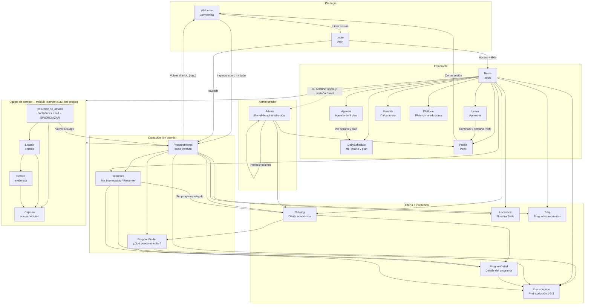
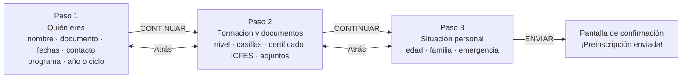

# Diagrama de navegación — Fundación ENID (Android)

Mapa de cómo se conectan las pantallas entre sí. Todo sale del código, no de
suposiciones: `navigation/Screen.kt` define las rutas, `ui/screens/AppRoot.kt`
decide qué se dibuja y cada pantalla declara a dónde lleva sus botones.

- **Rutas**: `app/src/main/java/com/fundacion/enid/navigation/Screen.kt`
- **Enrutador**: `app/src/main/java/com/fundacion/enid/ui/screens/AppRoot.kt`
- **Pila**: `app/src/main/java/com/fundacion/enid/navigation/NavController.kt`
- **Barra inferior**: `EnidTab` en `ui/components/Components.kt`

---

## 1. Mapa general (mermaid)

> El módulo `:campo` es una **hoja con grafo propio**: dentro, `NavHost` de
> `navigation-compose` maneja las cuatro pantallas y el botón atrás del sistema
> lo resuelve primero a él. Solo cuando la pila interna queda en el resumen, el
> retroceso pasa a la pila de `:app` y vuelve al Home. Por eso `Campo` no lleva
> parámetros y `Screen.kt` no conoce las cuatro rutas internas.

## 2. Rutas declaradas

| Ruta | Pantalla | Archivo | Recibe datos |
|------|----------|---------|--------------|
| `Welcome` | Bienvenida | `WelcomeScreen.kt` | — |
| `Login` | Acceso / registro | `AuthScreen.kt` | — |
| `Home` | Inicio (estudiante) | `HomeScreen.kt` | — |
| `ProspectHome` | Inicio (invitado) | `ProspectHomeScreen.kt` | — |
| `Catalog` | Oferta académica | `CatalogScreen.kt` | — |
| `ProgramDetail` | Detalle de programa | `ProgramDetailScreen.kt` | `programId: Int` |
| `ProgramFinder` | ¿Qué puedo estudiar? | `ProgramFinderScreen.kt` | — |
| `Intereses` | Mis interesados | `InteresesScreen.kt` | — |
| `Locations` | Nuestra Sede (Chía, teléfonos y redes) | `LocationsScreen.kt` | — |
| `Faq` | Preguntas frecuentes | `FaqScreen.kt` | — |
| `Learn` | Aprender (curso y progreso) | `LearnScreen.kt` | — |
| `Agenda` | Agenda de los próximos días | `AgendaScreen.kt` | — |
| `Profile` | Perfil de la persona | `ProfileScreen.kt` | — |
| `Admin` | Panel de administración | `AdminScreen.kt` | — |
| `Preinscription` | Preinscripción | `PreinscriptionScreen.kt` | `programaId: Int?` |
| `DailySchedule` | Mis clases | `DailyScheduleScreen.kt` | — |
| `Benefits` | Calculadora de beneficios | `BenefitsCalculatorScreen.kt` | — |
| `Platform` | Plataforma educativa | `PlatformScreen.kt` | — |
| `Campo` | Módulo de captura en campo | `CampoSeccion.kt` → `campo/ui/EnidAppRaiz.kt` | — |

## 3. Tabla de conexiones (pantalla → destinos)

| Desde | Botón / zona | Destino | Cómo |
|-------|--------------|---------|-----|
| Welcome | Iniciar sesión | `Login` | `navegar` |
| Welcome | Ingresar como invitado | `ProspectHome` | `reemplazarTodo` |
| Login | Acceso válido | `Home` | `reemplazarTodo` |
| Login | Invitado | `ProspectHome` | `reemplazarTodo` |
| ProspectHome | ¿Qué puedo estudiar? | `ProgramFinder` | `navegar` |
| ProspectHome | Ver resumen (⭐ **solo si hay intereses guardados**) | `Intereses` | `navegar` |
| ProspectHome | Oferta | `Catalog` | `navegar` |
| ProspectHome | Ver programas / Dejar mis datos | `Catalog`, `Preinscription(null)` | `navegar` |
| ProspectHome | Preinscripción | `Preinscription(null)` | `navegar` |
| ProspectHome | Sedes y contacto / Preguntas frecuentes | `Locations`, `Faq` | `navegar` |
| ProspectHome | **"Tu camino"**: pasos 1 a 4 | `Locations`, `Catalog`, `ProgramFinder`, `Preinscription(null)` | `navegar` |
| ProspectHome | **"Tu camino"**: pasos 5 a 10 | **ninguno** — son `enSede = true` | — |
| ProspectHome | ¿Ya eres estudiante ENID? | `Welcome` | `reemplazarTodo` |
| Home | Curso en progreso → Continuar | `Learn` | `navegar` |
| Home | Próxima clase / pestaña Agenda | `Agenda` | `navegar` |
| Home | Más servicios → Mi horario | `DailySchedule` | `navegar` |
| Home | Plataforma Educativa (tarjeta y enlace) | `Platform` | `navegar` |
| Home | Mi perfil / pestaña Perfil | `Profile` | `navegar` |
| Learn | Pestaña Aprender | `Learn` | pestaña |
| Agenda | Pestaña Agenda | `Agenda` | pestaña |
| Agenda | **VER HORARIO Y PLAN DE ESTUDIOS** | `DailySchedule` | `navegar` |
| Profile | Mi certificados | `Platform` | `navegar` |
| Profile | Ayuda y soporte | `Faq` | `navegar` |
| Profile | Panel de administración (solo admin) | `Admin` | `navegar` |
| Home | Panel Admin (solo administrador) | `Admin` | `navegar` |
| Admin | Pestaña Panel / Inicio | `Admin`, `Home` | pestaña |
| Home | Más servicios → Oferta / Preinscripción / Calculadora | `Catalog`, `Preinscription(null)`, `Benefits` | `navegar` |
| Home | Ver resumen (⭐ **solo si hay intereses guardados**) | `Intereses` | `navegar` |
| ProspectHome | Equipo de campo | `Campo` | `navegar` |
| Home | Más servicios → Captura en campo | `Campo` | `navegar` |
| Campo | Resumen → Volver a la app / botón atrás | `ProspectHome` o `Home` | `retroceder` |
| Catalog | Tarjeta de programa | `ProgramDetail(id)` | `navegar` |
| Catalog | ¿Qué puedo estudiar? | `ProgramFinder` | `navegar` |
| ProgramFinder | Recomendación | `ProgramDetail(id)` y `Preinscription(id)` | `navegar` |
| ProgramDetail | Quiero inscribirme | `Preinscription(id)` | `navegar` |
| Intereses | Ver programa / Preinscribirme | `ProgramDetail(id)`, `Preinscription(id)` | `navegar` |
| Intereses | Sin programa elegido | `Catalog` | `navegar` |
| Profile | Cerrar sesión | `Welcome` | `reemplazarTodo` |
| Cualquiera | Botón **"Volver"** de la cabecera | pantalla anterior de la pila | `onBack` |
| Cualquiera | Botón "atrás" del teléfono | pantalla anterior de la pila | `BackHandler` |
| `Campo` | Resumen → "Volver a la app" | pantalla anterior de la pila | `retroceder` |

> La flecha de la cabecera la dibuja `AppScaffold` **solo si recibe `onBack`**.
> Hasta el 5 Oct la recibía y no la pintaba: no había ninguna flecha de retorno
> en toda la app. Las pantallas que no la piden son las que son raíz de su
> rama (`Welcome`, `Home`, `ProspectHome`).
>
> `AuthScreen` y `WelcomeScreen` **no usan `AppScaffold`** (traen su propio
> layout), así que la flecha hay que dibujarlas a mano. `AuthScreen` la dibuja;
> `WelcomeScreen` es la raíz de la pila y no la necesita. `Platform` también la
> recibe. `Profile` es una pestaña y no lleva flecha de volver.
>
> `Screen.Platform` ya **no** tiene botón "Volver al inicio". Antes lo tenía y
> `AppRoot` lo encadenaba a `Screen.Home` fijo, de modo que un invitado que
> llegara allí saldría al Home de estudiante. El parámetro `onGoHome` estaba
> declarado y sin usar; se eliminó junto con el destino equivocado.

### Pantallas sin entrada propia

`Screen.Intereses` **no aparece en ninguna pestaña ni en ninguna tarjeta fija**.
Solo se abre desde `Home` y `ProspectHome`, y ambas lo hacen dentro de un
`if (primerInteres != null)`. Sin intereses registrados —es decir, en la
práctica, la primera vez— esa pantalla no tiene por dónde abrirse. Es un hueco
de navegación, no una decisión de diseño: está anotado como pendiente.

## 4. Barra inferior (`EnidTab`)

| Tab | Ruta | Visible para |
|-----|------|--------------|
| Inicio | `Home` (estudiante) / `ProspectHome` (invitado) | todos |
| Aprender | `Learn` | estudiante conectado |
| Agenda | `Agenda` | estudiante conectado |
| Perfil | `Profile` | estudiante conectado |
| Soporte | `Faq` | invitado, estudiante y administrador |
| Panel | `Admin` | solo `Rol.ADMIN` / `Rol.ADMINISTRATIVO` |

> **Horario ya no es pestaña.** El estudiante lo abre desde **Agenda** con
> **VER HORARIO Y PLAN DE ESTUDIOS**. `DailySchedule` conserva
> `activeTab = EnidTab.AGENDA`, de modo que la barra sigue marcando Agenda
> mientras se consulta el horario.

### Módulos que no navegan a otra pantalla

- **Aprender** no lleva a una lección aparte: marcar la fila cambia el
  porcentaje y guarda el avance en el teléfono. El botón **Continuar** del Home
  es la entrada principal.
- **Perfil** despliega sus datos en la misma pantalla; no crea una ruta nueva
  para “Mis datos”. Solo los ajustes con destino propio (certificados, ayuda y
  panel) navegan.

El administrador **no ve los módulos de estudiante**: su lista es
**Inicio · Panel · Soporte**. El estudiante ve **Inicio · Aprender · Agenda ·
Perfil** y el invitado solo Inicio y Soporte. El horario detallado se consulta
desde Agenda y el sistema de pagos se retiró por completo el 27 Oct 2026.

**Quién ve qué pestañas no lo decide cada pantalla.** `AppScaffold` lee
`SesionUi.conectado` y calcula la lista con `tabsSegunSesion(...)`; **ninguna
pantalla pasa el parámetro `tabs`**. Antes el valor por defecto era
`EnidTab.entries` y ocho pantallas no pasaban nada, así que el invitado veía
pestañas que no le correspondían. Hoy la barra se calcula solo con
`tabsSegunSesion(...)`.

El tab **Inicio** tampoco siempre va a `Home`: `AppRoot` lo resuelve según la
sesión (`inicioDelUsuario`). El invitado que abre el catálogo desde la barra
vuelve a `ProspectHome`, no al Home de estudiante.

## 5. Flujo interno de la preinscripción (3 pasos)

No cambia de ruta: los tres pasos viven en `PreinscriptionScreen` y el avance es
estado local (`paso`).

- Entrada al programa: se puede llegar con `programaId` (desde detalle, finder o
  intereses) o sin él (`null`, desde los accesos directos del Home); si es `null`
  el formulario deja elegir el programa en el paso 1.
- La **carrera/programa** y el **año o ciclo** se eligen en el paso 1. El ciclo
  sale de `DataRepository.ciclos` (lista cerrada), no se escribe a mano.
- El paso 2 pide el **certificado del ICFES** como documento adjunto, no el
  número del ICFES: el número se eliminó del formulario.
- Al enviar se llama a `DataRepository.registrarPreinscripcion` y se muestra la
  confirmación; el registro queda en el dispositivo, aparece en `Intereses` y
  actualiza los datos de solo lectura de **Perfil**.

## 6. Salidas a apps externas (fuera del diagrama)

`data/EnlacesExternos.kt` es la **única** salida de la app hacia otra aplicación:
WhatsApp, llamadas, mapa, web, plataforma y redes sociales. Ninguna pantalla llama a
`context.startActivity` por su cuenta; una prueba lo verifica leyendo el
código fuente.

Con `habilitados = false` **no se abre nada**: solo queda el registro en el log.
Por eso la barra del asesor y los botones de sede son visibles pero inertes.

**Cada función devuelve `Boolean`**: `true` solo si la app externa se abrió de
verdad, `false` si el interruptor está apagado o si el dispositivo no tiene
ninguna app capaz de atender la acción. Sin ese valor de retorno una pantalla
no puede distinguir "se abrió" de "no pasó nada".

| Desde | Acción | App destino |
|-------|--------|-------------|
| Varias | Contactar asesor | WhatsApp |
| Locations | Llamar a sede | Marcador |
| Locations | Cómo llegar | Mapa |
| Varias | Enlace institucional | Navegador |
| Platform | Ir a la plataforma | Navegador |

> **Sin módulo de pagos.** El 27 Oct 2026 se retiraron `Payments`, `Pse`, la
> pestaña Pagos, los modelos de alerta, el historial, la pasarela y los montos.
> La app no procesa pagos ni recibe datos bancarios; el pago se coordina con un
> asesor o en la sede de Chía.

## 4. Salidas externas desde Nuestra Sede e Inicio

La pantalla **Nuestra Sede** y el final del **Inicio** comparten la fila
`RedesSociales`. No son destinos internos: pasan por `EnlacesExternos` y
devuelven si la app externa se abrió.

| Desde | Botón | Destino | Cómo |
|-------|-------|---------|------|
| Inicio / Nuestra Sede | Facebook | `https://www.facebook.com/Enid.Escuela/` | `EnlacesExternos.abrirFacebook` |
| Inicio / Nuestra Sede | Instagram | `https://www.instagram.com/fundacionenid/` | `EnlacesExternos.abrirInstagram` |
| Inicio / Nuestra Sede | YouTube | `https://www.youtube.com/channel/UCb_yG90hqnKELFCBp0Dcqeg` | `EnlacesExternos.abrirYouTube` |
| Nuestra Sede | 316 630 1033 / 313 204 8325 | Marcador del teléfono | `EnlacesExternos.abrirLlamar` (un número por toque) |
| Nuestra Sede | Cómo Llegar | Maps / Waze con la dirección de Chía | `EnlacesExternos.abrirMapa` |

Con `EnlacesExternos.habilitados = false` (pruebas) los toques se registran en
log y **no se abre ninguna app externa**.
