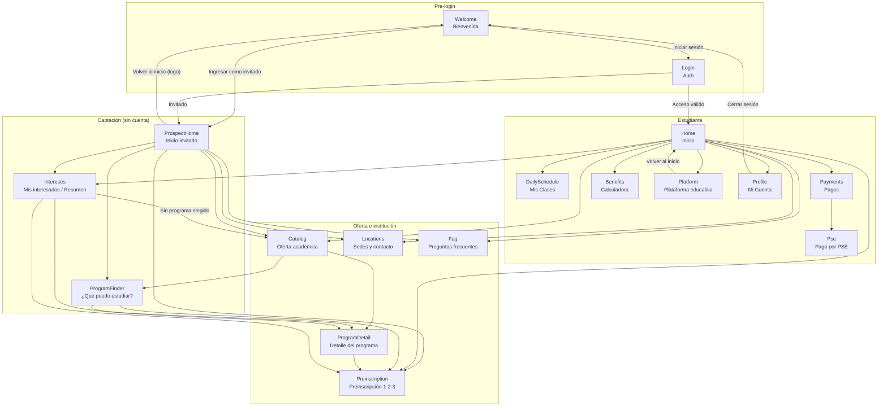
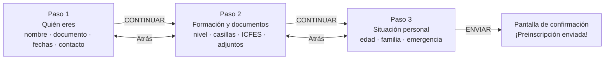

# Diagrama de navegación — Fundación ENID (Android)

Mapa de cómo se conectan las pantallas entre sí. Todo sale del código, no de
suposiciones: `navigation/Screen.kt` define las rutas, `ui/screens/AppRoot.kt`
decide qué se dibuja y cada pantalla declara a dónde lleva sus botones.

- **Rutas**: `app/src/main/java/com/fundacion/enid/navigation/Screen.kt`
- **Enrutador**: `app/src/main/java/com/fundacion/enid/ui/screens/AppRoot.kt`
- **Pila**: `app/src/main/java/com/fundacion/enid/navigation/NavController.kt`
- **Barra inferior**: `EnidTab` en `ui/components/Components.kt`

---

## 1. Mapa general (mermaid)

## 2. Rutas declaradas

| Ruta | Pantalla | Archivo | Recibe datos |
|------|----------|---------|--------------|
| `Welcome` | Bienvenida | `WelcomeScreen.kt` | — |
| `Login` | Acceso / registro | `AuthScreen.kt` | — |
| `Home` | Inicio (estudiante) | `HomeScreen.kt` | — |
| `ProspectHome` | Inicio (invitado) | `ProspectHomeScreen.kt` | — |
| `Catalog` | Oferta académica | `CatalogScreen.kt` | — |
| `ProgramDetail` | Detalle de programa | `ProgramDetailScreen.kt` | `programId: Int` |
| `ProgramFinder` | ¿Qué puedo estudiar? | `ProgramFinderScreen.kt` | — |
| `Intereses` | Mis interesados | `InteresesScreen.kt` | — |
| `Locations` | Sedes y contacto | `LocationsScreen.kt` | — |
| `Faq` | Preguntas frecuentes | `FaqScreen.kt` | — |
| `Profile` | Mi cuenta | `ProfileScreen.kt` | — |
| `Preinscription` | Preinscripción | `PreinscriptionScreen.kt` | `programaId: Int?` |
| `DailySchedule` | Mis clases | `DailyScheduleScreen.kt` | — |
| `Payments` | Pagos | `PaymentsScreen.kt` | — |
| `Benefits` | Calculadora de beneficios | `BenefitsCalculatorScreen.kt` | — |
| `Platform` | Plataforma educativa | `PlatformScreen.kt` | — |
| `Pse` | Pago por PSE | `PseScreen.kt` | — |

## 3. Tabla de conexiones (pantalla → destinos)

| Desde | Botón / zona | Destino | Cómo |
|-------|--------------|---------|-----|
| Welcome | Iniciar sesión | `Login` | `navegar` |
| Welcome | Ingresar como invitado | `ProspectHome` | `reemplazarTodo` |
| Login | Acceso válido | `Home` | `reemplazarTodo` |
| Login | Invitado | `ProspectHome` | `reemplazarTodo` |
| ProspectHome | ¿Qué puedo estudiar? | `ProgramFinder` | `navegar` |
| ProspectHome | Ver resumen | `Intereses` | `navegar` |
| ProspectHome | Oferta | `Catalog` | `navegar` |
| ProspectHome | Preinscripción / Dejar mis datos | `Preinscription(null)` | `navegar` |
| ProspectHome | Sedes y FAQ | `Locations`, `Faq` | `navegar` |
| ProspectHome | Logo de inicio | `Welcome` | `reemplazarTodo` |
| Home | Mis Clases | `DailySchedule` | `navegar` |
| Home | Pagos | `Payments` | `navegar` |
| Home | Plataforma educativa | `Platform` | `navegar` |
| Home | Mi cuenta | `Profile` | `navegar` |
| Home | Oferta / Preinscripción / FAQ / Beneficios / Perfil / Intereses | `Catalog`, `Preinscription`, `Faq`, `Benefits`, `Profile`, `Intereses`, `Locations` | `navegar` |
| Catalog | Tarjeta de programa | `ProgramDetail(id)` | `navegar` |
| Catalog | ¿Qué puedo estudiar? | `ProgramFinder` | `navegar` |
| ProgramFinder | Recomendación | `ProgramDetail(id)` y `Preinscription(id)` | `navegar` |
| ProgramDetail | Quiero inscribirme | `Preinscription(id)` | `navegar` |
| Intereses | Ver programa / Preinscribirme | `ProgramDetail(id)`, `Preinscription(id)` | `navegar` |
| Intereses | Sin programa elegido | `Catalog` | `navegar` |
| Payments | Pagar por PSE | `Pse` | `navegar` |
| Platform | Volver al inicio | `Home` | `reemplazarTodo` |
| Profile | Cerrar sesión | `Welcome` | `reemplazarTodo` |
| Cualquiera | Botón "Atrás" de la cabecera | pantalla anterior de la pila | `retroceder` |
| Cualquiera | Botón "atrás" del teléfono | pantalla anterior de la pila | `BackHandler` |

## 4. Barra inferior (`EnidTab`)

| Tab | Ruta | Visible para |
|-----|------|--------------|
| Inicio | `Home` (estudiante) / `ProspectHome` (invitado) | todos |
| Horario | `DailySchedule` | solo conectado |
| Pagos | `Payments` | solo conectado |
| Soporte | `Faq` | todos |

El tab **Inicio** no siempre va a `Home`: `AppRoot` lo resuelve según la sesión
(`inicioDelUsuario`). El invitado que abre el catálogo desde la barra vuelve a
`ProspectHome`, no al Home de estudiante.

## 5. Flujo interno de la preinscripción (3 pasos)

No cambia de ruta: los tres pasos viven en `PreinscriptionScreen` y el avance es
estado local (`paso`).

- Entrada al programa: se puede llegar con `programaId` (desde detalle, finder o
  intereses) o sin él (`null`, desde los accesos directos del Home); si es `null`
  el formulario deja elegir el programa en el paso 1.
- Al enviar se llama a `DataRepository.registrarPreinscripcion` y se muestra la
  confirmación; el registro queda en el dispositivo y aparece en `Intereses`.

## 6. Salidas a apps externas (fuera del diagrama)

`data/EnlacesExternos.kt` centraliza WhatsApp, llamadas, mapa, web y PSE. Con
`habilitados = false` **no se abre nada**: solo queda el registro en el log. Por
eso la barra del asesor y los botones de sede son visibles pero inertes.

| Desde | Acción | App destino |
|-------|--------|-------------|
| Varias | Contactar asesor | WhatsApp |
| Varias | Llamar a la Fundación | Marcador |
| Locations | Ver ubicación | Mapa |
| Varias | Enlace institucional | Navegador |
| Payments | Pagar por PSE | PSE bancario |
